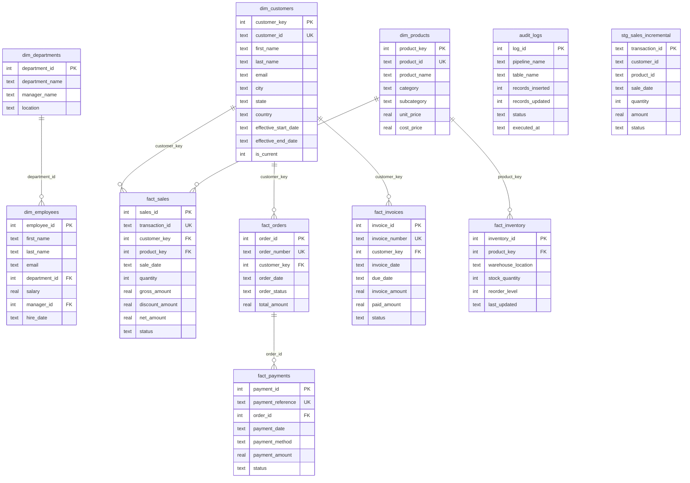
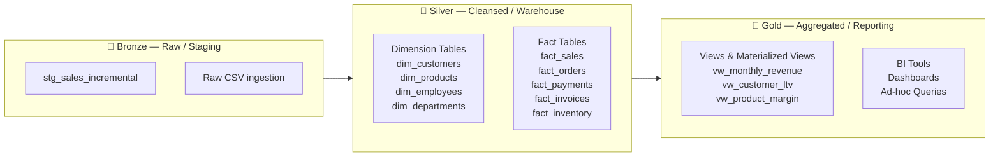
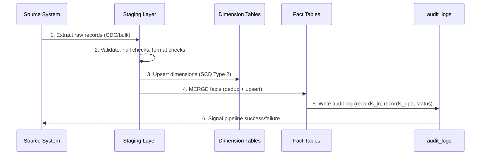
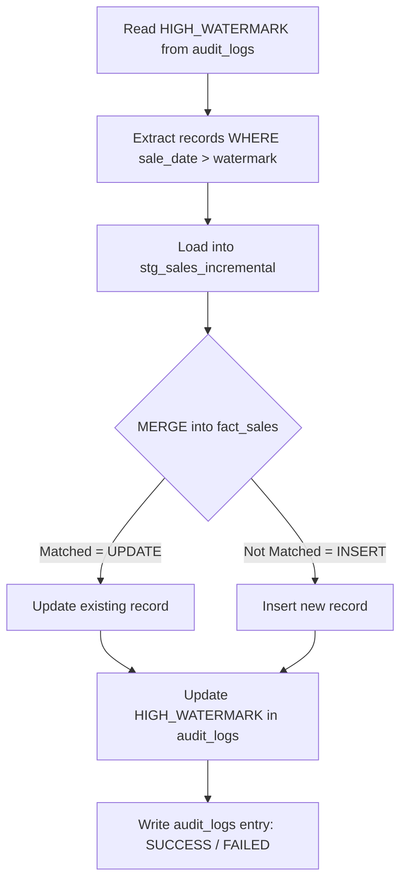
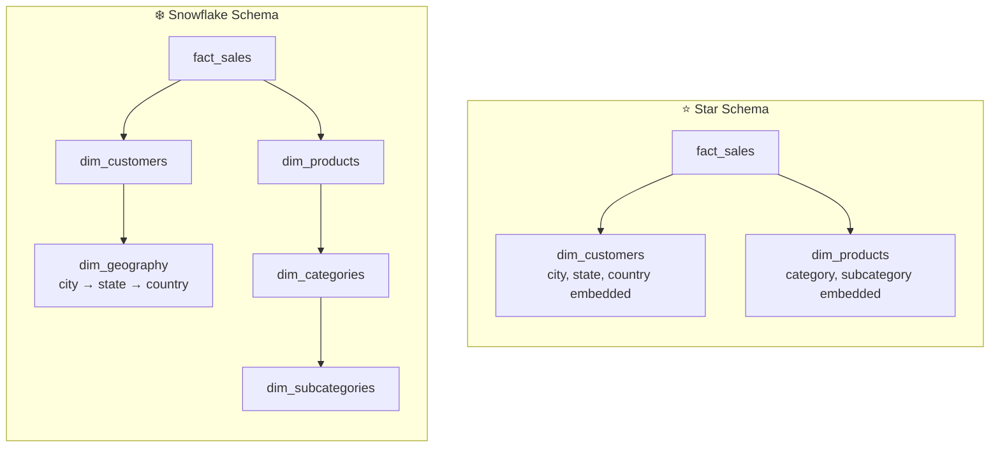

# 🏛️ Architecture: SQL for Data Engineering Warehouse

> **Project 02 — Data Engineering Diaries**  
> Architecture document for the enterprise data warehouse used across all 55 SQL modules.

---

## Table of Contents

- [Overview](#overview)
- [Warehouse Schema ER Diagram](#warehouse-schema-er-diagram)
- [Layer Architecture](#layer-architecture)
- [Data Flow Diagram](#data-flow-diagram)
- [Star Schema vs Snowflake Schema](#star-schema-vs-snowflake-schema)
- [Table Descriptions](#table-descriptions)
- [Schema Design Rationale](#schema-design-rationale)

---

## Overview

The `warehouse_db` implements a **star schema** modeled after a mid-size B2B/B2C e-commerce operation. The schema is intentionally multi-domain to allow SQL exercises spanning:

- **Retail analytics** (fact_sales, dim_products, dim_customers)
- **Order management** (fact_orders, fact_payments)
- **Finance / AR** (fact_invoices)
- **Inventory management** (fact_inventory)
- **Healthcare analytics** (healthcare_claims)
- **Banking analytics** (banking_transactions)
- **IoT / Streaming** (iot_sensor_data)
- **ETL operations** (stg_sales_incremental, audit_logs)

This breadth ensures that SQL patterns learned here — window functions, CTEs, SCDs, incremental loading — translate directly to real production environments.

---

## Warehouse Schema ER Diagram

---

## Layer Architecture

The warehouse uses a **three-tier medallion-inspired architecture**:

### Layer Descriptions

| Layer | Tables | Role | SQL Patterns |
|-------|--------|------|-------------|
| **Bronze (Raw)** | `stg_*` | Accept raw source data as-is; no transformation | INSERT, COPY |
| **Silver (Warehouse)** | `dim_*`, `fact_*` | Cleansed, typed, validated, historical tracking | MERGE, SCD Type 2, incremental load |
| **Gold (Reporting)** | Views, MVs | Business-ready aggregations, KPIs | CTEs, Window Functions, GROUP BY |

---

## Data Flow Diagram

**Incremental Load Flow (m49):**

---

## Star Schema vs Snowflake Schema

Both schemas are implemented in this project (`m43`, `m44`). Here is a direct comparison:

| Dimension | Star Schema | Snowflake Schema |
|-----------|-------------|-----------------|
| **Structure** | Denormalized dims (flat) | Normalized dims (hierarchical) |
| **Query Speed** | ⚡ Faster (fewer JOINs) | 🐌 Slower (more JOINs) |
| **Storage** | More (redundant data) | Less (normalized) |
| **Maintenance** | Simpler | Complex |
| **Use Case** | Analytics / BI dashboards | OLTP-adjacent, strict normalization |
| **Industry Preference** | ✅ Default choice for DW | Used when storage cost is primary concern |

**Recommendation:** Use **Star Schema** for analytics workloads. The JOIN overhead in Snowflake schema degrades performance at billion-row scale with no meaningful benefit in modern columnar warehouses.

---

## Table Descriptions

### dim_customers
Implements **SCD Type 2** with `effective_start_date`, `effective_end_date`, and `is_current` columns. When a customer's address changes, the old row gets `is_current = 0` and `effective_end_date` set; a new row is inserted with `is_current = 1`.

**Key Columns:**
- `customer_key` — Surrogate key (auto-increment integer)
- `customer_id` — Natural/business key (e.g., 'CUST001')
- `is_current` — 1 = active record, 0 = historical

### dim_products
Product catalog with category hierarchy embedded (star schema). `product_key` is the surrogate key; `product_id` is the business key.

### fact_sales
Primary revenue fact table. Contains additive measures (`gross_amount`, `discount_amount`, `net_amount`, `quantity`) that can be summed across any dimension. Uses surrogate keys from dimension tables for joins.

### audit_logs
Records every ETL pipeline execution. Used in m49 (incremental loading) as the HIGH_WATERMARK store and in m53 (audit tables) for pipeline observability.

### stg_sales_incremental
The staging buffer for incremental sales loads. Records land here from the source system and are then MERGEd into `fact_sales` using the patterns demonstrated in m49 and m54.

---

## Schema Design Rationale

1. **Surrogate keys over natural keys** — All dimension tables use auto-increment integer surrogate keys as the join key to fact tables. This insulates the warehouse from changes in source system key formats.

2. **Separate customer_id as business key** — `customer_id` (TEXT, UNIQUE) is preserved alongside `customer_key` (INTEGER PK) so that source-system lookups remain possible without needing to know the surrogate key.

3. **SCD Type 2 on dim_customers** — Only `dim_customers` has SCD Type 2 columns because customer attributes (address, tier) commonly change over time and historical accuracy matters for cohort analysis.

4. **Additive measures in fact tables** — All numeric columns in fact tables (`gross_amount`, `net_amount`, `quantity`) are fully additive — they can be summed across all dimensions without distortion.

5. **TEXT for dates in SQLite** — SQLite has no native DATE type. Dates are stored as ISO 8601 TEXT (`'2026-07-20'`) for portability. Date functions like `strftime` work correctly on this format. PostgreSQL/Snowflake versions use native DATE type.

---

*See [design-decisions.md](design-decisions.md) for the rationale behind each architectural choice.*
