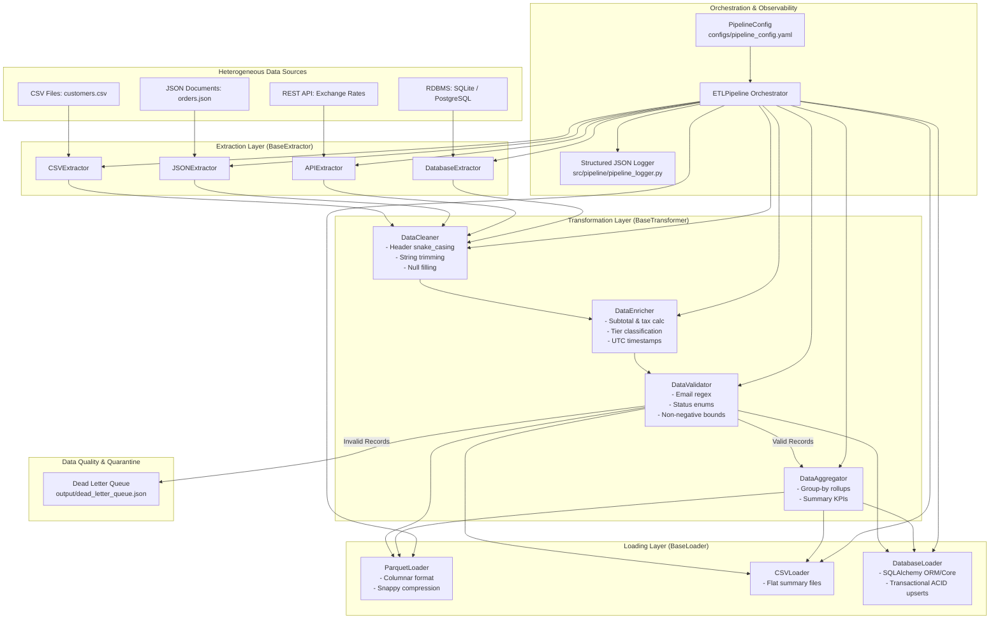

# Enterprise ETL Pipeline Architecture

This document presents the end-to-end architectural design for the **Python Modular ETL Framework** (`04_python_etl`) in the **Data Engineering Diaries** series by **Sathiya Murthy**.

---

## 1. System Architecture Overview

The architecture implements a modular, decoupled **Extract-Transform-Load (ETL)** pipeline using the **Strategy Pattern** for interchangeable components, the **Factory Pattern** for dynamic instantiation, and an isolated **Dead Letter Queue (DLQ)** pattern for schema and quality error quarantine.

---

## 2. Component Architecture Breakdown

### 2.1 Extraction Layer (`src/extractors/`)
All extractors inherit from the abstract base class `BaseExtractor` requiring implementation of `extract() -> pd.DataFrame`.
- **`CSVExtractor`**: Ingests flat delimited files, supporting full dataset loading and memory-efficient streaming chunk generation (`extract_chunks()`).
- **`JSONExtractor`**: Ingests standard JSON arrays and line-delimited JSON (JSONL/ndjson), normalizing nested JSON sub-trees via `pd.json_normalize`.
- **`APIExtractor`**: Fetches HTTP REST API endpoints with configurable timeouts, request headers, exponential backoff retries, and fallback offline mock testing support.
- **`DatabaseExtractor`**: Reads tables or executes parameterized SQL SELECT queries against relational databases using SQLAlchemy connection pools.

### 2.2 Transformation Layer (`src/transformers/`)
Transformers implement `BaseTransformer` requiring `transform(df: pd.DataFrame) -> pd.DataFrame`.
- **`DataCleaner`**: Standardizes column names into lowercase `snake_case`, strips whitespace from string columns, fills missing values, and drops duplicates.
- **`DataEnricher`**: Derives calculated domain columns including order subtotals, tax rates, grand totals, customer tier classifications (`vip`, `gold`, `silver`, `bronze`), and UTC processing timestamps.
- **`DataValidator`**: Enforces strict business quality rules (regex validation for email addresses, enum validation for order statuses, non-negative monetary thresholds). Records failing validation are filtered out and written to a Dead Letter Queue (DLQ) JSON artifact.
- **`DataAggregator`**: Computes Analytical Rollups (e.g., total spent sum, average, count per country/category).

### 2.3 Loading Layer (`src/loaders/`)
Loaders inherit from `BaseLoader` requiring `load(df: pd.DataFrame) -> bool`.
- **`ParquetLoader`**: Exports DataFrame datasets to binary columnar Apache Parquet files compressed with Snappy, supporting optional directory partitioning (`partition_cols`).
- **`CSVLoader`**: Exports summary metrics and reports to flat CSV files using atomic file writing (`safe_write_json` style atomic temporary file rename).
- **`DatabaseLoader`**: Persists processed tables into relational databases (`dim_customers`, `fact_orders`, `agg_daily_sales`) wrapped in SQLAlchemy transactions (`engine.begin()`).

### 2.4 Pipeline Orchestrator & Monitoring (`src/pipeline/`)
- **`PipelineConfig`**: Parses and validates `pipeline_config.yaml`, raising `ConfigurationError` if mandatory sections (`pipeline`, `extractors`, `transformers`, `loaders`) are missing.
- **`JSONLogFormatter`**: Emits JSON-formatted structured log lines (`timestamp`, `level`, `logger`, `message`, `module`, `line`, `exception`) suited for log aggregation backends (Datadog, Splunk, CloudWatch).
- **`ETLPipeline`**: Coordinates lifecycle execution, captures start/end timestamps, tallies extracted/transformed/loaded record metrics, catches breaking exceptions, and returns an execution summary report.

---

## 3. Design Patterns Applied

| Pattern | Location | Business Context & Rationale |
| :--- | :--- | :--- |
| **Strategy Pattern** | `BaseExtractor`, `BaseTransformer`, `BaseLoader` | Decouples ETL algorithms from pipeline execution logic. New sources or targets can be introduced without modifying existing pipeline code. |
| **Factory / Polymorphism** | `ETLPipeline.run()` | Dynamically instantiates the concrete extractor or loader based on `type` key in `pipeline_config.yaml`. |
| **Dead Letter Queue (DLQ)** | `DataValidator._quarantine_records()` | Prevents a single malformed row from failing a multi-million record batch job while preserving data observability for debugging. |
| **Atomic File Writes** | `src/utils/file_utils.py` (`safe_write_json`) | Writes output payloads to temporary `.tmp` files before issuing an atomic OS `rename/move` operation, avoiding partial read corruptions by downstream consumers. |

---

## 4. Operational & Fault-Tolerance Principles

1. **Idempotency**: All loaders support overwrite or transactional replacement modes (`if_exists="replace"` or file overwrite) ensuring re-running the pipeline produces identical state.
2. **Schema Safety**: Dynamic type coercion in `schema_utils.py` handles mixed string-to-numeric or timestamp parsing cleanly.
3. **Structured Logging**: Log messages include execution context, record counts, and traceback details for swift troubleshooting.
