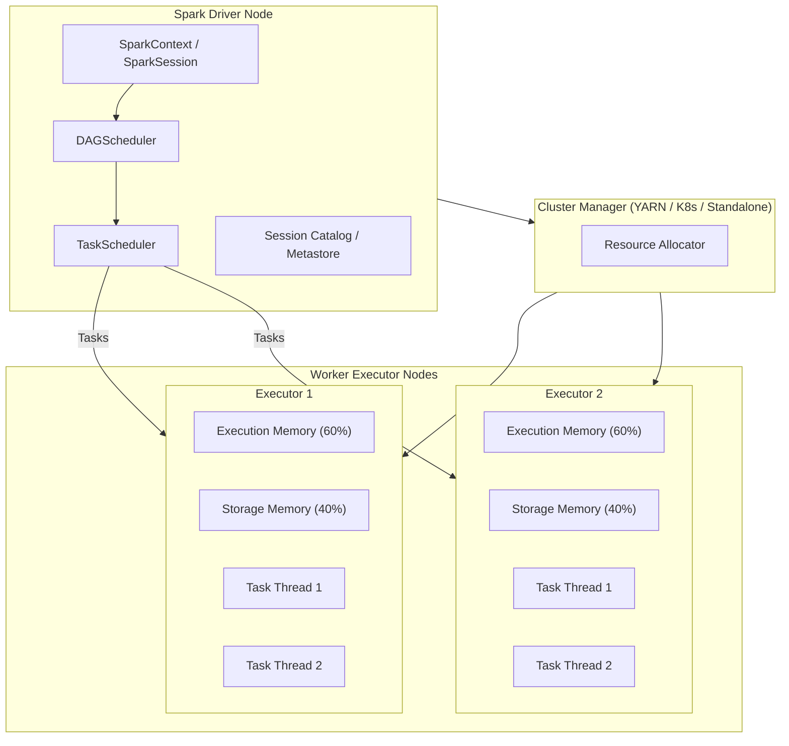
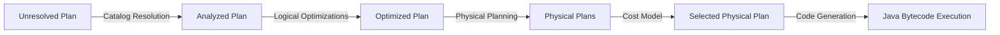
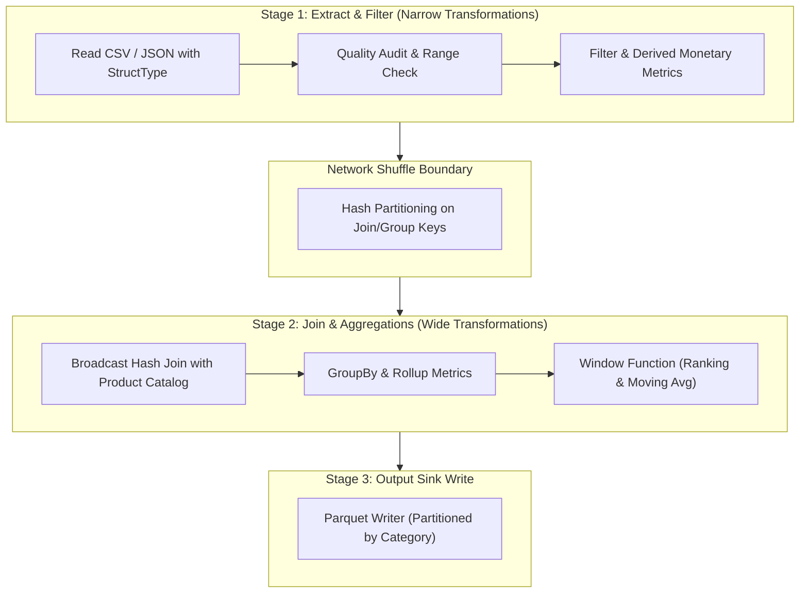

# Project 05 Architecture: PySpark Core & Distributed DataFrames

## 1. System Architecture Overview

PySpark operates on a master-worker architecture comprising a single **Driver Program** and multiple distributed **Executors** managed by a Cluster Manager (Local, YARN, Kubernetes, or Databricks Runtime).

---

## 2. Catalyst Query Optimizer & Tungsten Engine

All PySpark DataFrame operations benefit from two core internals:

### Catalyst Optimizer Flow
1. **Unresolved Logical Plan**: Generated directly from PySpark SQL or DataFrame API calls.
2. **Analyzed Logical Plan**: Column names and types are resolved against the catalog.
3. **Optimized Logical Plan**: Pushes filters down (`filterPushdown`), prunes unused columns, and collapses adjacent projections.
4. **Physical Plans**: Generates multiple physical execution strategies (e.g. BroadcastHashJoin vs SortMergeJoin).
5. **Cost Model Evaluation**: Selects the optimal physical plan based on data statistics.
6. **Code Generation (Tungsten)**: Generates bytecode for memory-efficient execution without JVM object overhead.

---

## 3. Data Processing DAG & Execution Stages

The pipeline constructed in `src/etl_pipeline.py` executes as a Directed Acyclic Graph (DAG) divided into stages by shuffle boundaries:

---

## 4. Memory Layout Breakdown

Each executor process allocates memory according to the Unified Memory Manager model (`spark.memory.fraction` = 0.6 default):

| Memory Segment | Configuration Flag | Purpose |
|---|---|---|
| **Reserved Memory** | Hardcoded (300 MB) | System framework internal allocation |
| **User Memory** | `1 - spark.memory.fraction` (40%) | User data structures, UDF variables, custom Python objects |
| **Execution Memory** | Part of `spark.memory.fraction` | Shuffle buffers, hash tables for joins, sort buffers |
| **Storage Memory** | Part of `spark.memory.fraction` | Cached DataFrames (`persist`), broadcast variables |
| **Off-Heap Memory** | `spark.memory.offHeap.size` | Arrow buffers, Tungsten off-heap native memory allocations |
