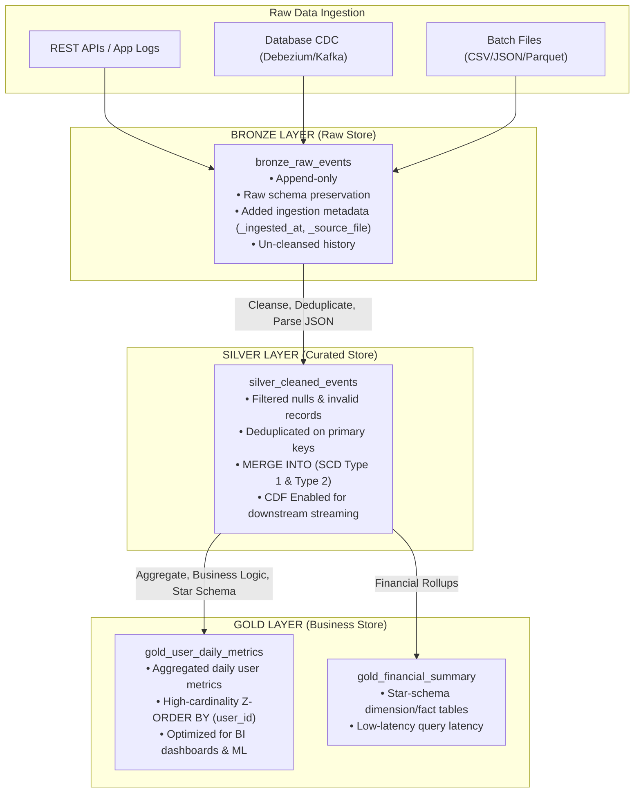

# Architecture Design: Delta Lake ACID Transactions & Medallion Lakehouse

> **Data Engineering Diaries** | Enterprise Architecture Specification

---

## 1. Executive Summary

This architecture document defines the design standards, transaction log mechanics, storage layout, and processing pipeline for Delta Lake in enterprise lakehouses. Delta Lake decouples storage and compute while maintaining full ACID transaction guarantees on top of cloud object stores (AWS S3, Azure Data Lake Storage Gen2, Google Cloud Storage).

---

## 2. Medallion Architecture (Bronze → Silver → Gold)

The Medallion pattern organizes data refinement into three distinct physical and logical layers to ensure data quality, traceability, and high performance.



---

## 3. Delta Transaction Log (`_delta_log`) Internals

At the core of Delta Lake's ACID reliability is the transaction log (`_delta_log`), a directory located at the root of every Delta table.

```
/lakehouse/silver/events/
├── _delta_log/
│   ├── 00000000000000000000.json      # Commit 0: Table creation
│   ├── 00000000000000000001.json      # Commit 1: Append initial batch
│   ├── 00000000000000000002.json      # Commit 2: MERGE upsert
│   ├── 00000000000000000010.checkpoint.parquet  # State snapshot every 10 commits
│   └── 00000000000000000010.json
├── part-00000-c000.snappy.parquet     # Active physical data file
├── part-00001-c000.snappy.parquet     # Active physical data file
└── part-00002-c000.snappy.parquet     # Tombstoned file (removed in Commit 2)
```

### Protocol Mechanics
1. **Atomic Commit Protocol**: Writers perform changes on local worker memory, write new Parquet files, and attempt to write commit file `000000N.json` atomically.
2. **Optimistic Concurrency Control (OCC)**: Delta assumes concurrent transactions rarely conflict. If Writer B commits while Writer A is computing:
   - Writer A re-reads the latest commit log.
   - Delta checks for conflict: If Writer B modified files that Writer A read/updated, Writer A fails with `ConcurrentModificationException`. Otherwise, Writer A automatically retries.
3. **Checkpointing**: Every 10 commits, Delta aggregates all active file states into a Parquet checkpoint file (`.checkpoint.parquet`). Readers load the latest checkpoint and replay remaining JSON log commits, eliminating the need to list millions of JSON files.

---

## 4. Layer Responsibility Matrix

| Feature | Bronze Layer | Silver Layer | Gold Layer |
| :--- | :--- | :--- | :--- |
| **Primary Goal** | Raw Ingestion & Auditability | Cleansing & Standardization | Business Reporting & Feature Store |
| **Write Strategy** | Append-Only | Upsert (MERGE) / SCD Type 1 & 2 | Overwrite / Selective Partition Overwrite |
| **Data Quality** | Schema Preservation | Enforced NOT NULL & CHECK constraints | Business aggregations validated |
| **CDF Status** | Optional | **Enabled** (for downstream subscribers) | Disabled (usually static read) |
| **Compaction Strategy** | Bin-Packing OPTIMIZE | OPTIMIZE + Z-ORDER BY primary keys | OPTIMIZE + Z-ORDER BY report keys |
| **Retention Policy** | 30–90 Days | 90–365 Days | Multi-Year / Permanent |

---

## 5. Concurrency & Isolation Levels

Delta Lake supports two Spark isolation levels:
1. **WriteSerializable** (Default): Ensures write operations are serializable. Concurrent readers see consistent table snapshots without locks.
2. **Serializable**: Stricter mode preventing phantom reads across multi-statement transactions.
