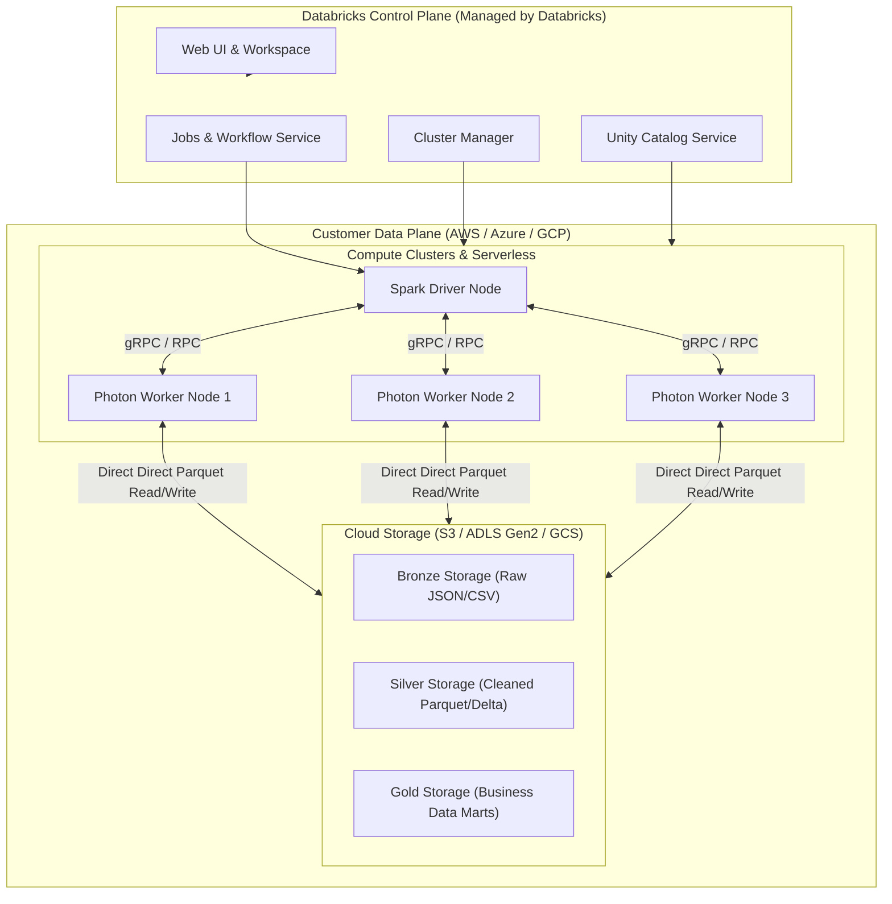
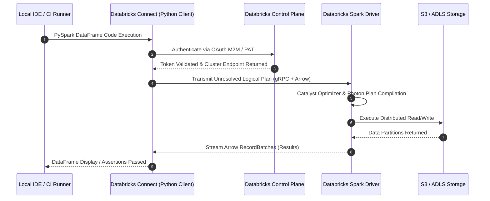

# Databricks Enterprise Lakehouse Architecture & Security Model

## 1. Executive Platform Architecture

Databricks operates on a decoupled architecture separating the **Control Plane** (managed by Databricks) from the **Data Plane** (running inside the customer's cloud account, e.g. AWS, Azure, GCP).

---

## 2. Decoupled Control Plane vs. Data Plane

| Architecture Component | Hosted Location | Key Responsibilities | Security Boundaries |
| :--- | :--- | :--- | :--- |
| **Control Plane** | Databricks Cloud Account | Notebook UI, REST APIs, job scheduler, query history, access control rules, metastore index | No raw data stored here; only metadata and control plane logs. |
| **Data Plane** | Customer Cloud Account | Spark driver/workers, serverless SQL warehouses, local SSD caches, memory processing | Data never leaves customer network boundary except for UI previews. |
| **Unity Catalog** | Centralized Service | Enterprise RBAC, Lineage tracking, Dynamic data masking, Audit logs | Central governance hub for multi-workspace deployments. |

---

## 3. Remote Connectivity: Databricks Connect v2 Architecture

Databricks Connect v2 uses the open-source **Spark Connect** protocol based on **gRPC** and **Apache Arrow**.

---

## 4. Unity Catalog Governance & Network Security

- **Storage Credentials**: Encapsulate cloud IAM roles (AWS IAM Role / Azure Managed Identity) so users never handle raw storage keys.
- **External Locations**: Bind cloud storage URIs (e.g. `s3://company-gold/`) to specific storage credentials.
- **Single-User / Shared Security Modes**:
  - `SINGLE_USER`: Dedicated cluster for single developer with full Python/R support.
  - `USER_ISOLATION` / `SHARED`: Multi-tenant cluster enforcing Unity Catalog SQL and Python access controls between users.
