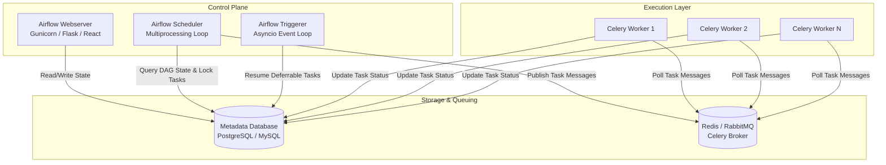
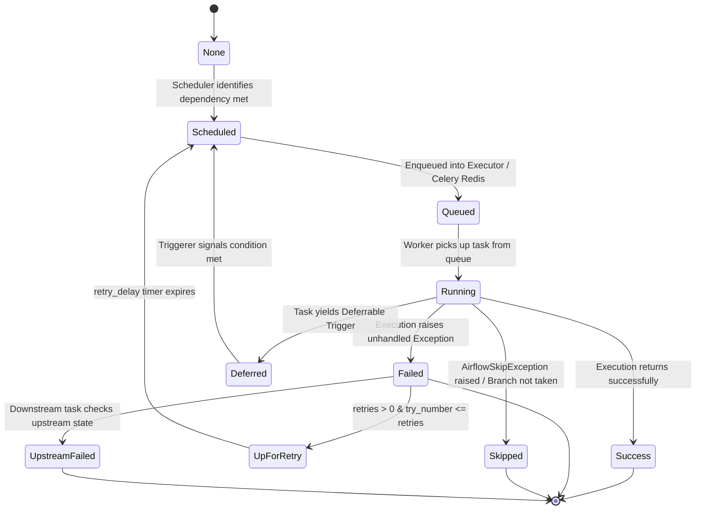

# System Architecture: Apache Airflow Pipeline Orchestration

This document details the internal architecture, component interaction lifecycle, state machine transitions, and security models of **Apache Airflow 2.9+**.

---

## 1. High-Level Architecture Overview

Apache Airflow is a distributed workflow management platform designed around a single source of truth (the **Metadata Database**) and a central task dispatch engine (the **Scheduler**).



---

## 2. Core Component Deep Dive

### 2.1 Airflow Scheduler
The Scheduler is the heart of Airflow. It runs two primary loops:
1. **DAG Parsing Loop (`DagFileProcessorManager`)**:
   - Scans `$AIRFLOW_HOME/dags` continuously for `.py` files.
   - Spawns subprocesses (`DagFileProcessorProcess`) to execute DAG files and serialize DAG objects into JSON format in the `dag_code` and `serialized_dag` tables.
2. **Scheduling Loop (`SchedulerJob`)**:
   - Queries the database for `DAGRun` records due for execution.
   - Evaluates task dependencies (`TaskInstance` state checks).
   - Sets task state to `SCHEDULED` and transitions them to `QUEUED` by pushing execution payloads to the Executor.

### 2.2 Metadata Database
Stores all operational state:
- **`dag`**: DAG definitions, pause status, owners.
- **`dag_run`**: Specific execution instances (`execution_date`, `run_id`, `state`).
- **`task_instance`**: Individual task attempt state (`start_date`, `end_date`, `duration`, `state`, `try_number`).
- **`xcom`**: Cross-task message key-value store.
- **`connection` & `variable`**: Encrypted credentials and runtime configurations.

### 2.3 Airflow Executor
The Executor determines HOW tasks are dispatched:
- **SequentialExecutor**: Single-process, uses SQLite. For testing only.
- **LocalExecutor**: Runs tasks as local subprocesses on the scheduler node. Limited by node CPU/RAM.
- **CeleryExecutor**: Dispatches tasks to a distributed Redis/RabbitMQ queue. Workers run independently.
- **KubernetesExecutor**: Dynamically spawns a dedicated K8s Pod per task instance. Provides perfect resource isolation and per-task Docker container images.
- **CeleryKubernetesExecutor**: Combines Celery (for high-volume short tasks) with Kubernetes (for heavy compute/GPU tasks).

### 2.4 Airflow Triggerer (Async Deferrable Operators)
Introduced in Airflow 2.2+, the Triggerer runs an `asyncio` event loop. Instead of blocking a worker slot while waiting for external events (e.g., waiting for an EMR cluster to launch), a task can "defer" itself to the Triggerer, freeing up worker resources completely.

---

## 3. Task Instance State Machine

The state transition lifecycle of an individual Airflow task instance:



---

## 4. Executor Comparison Matrix

| Executor | Concurrency Limit | Resource Isolation | Setup Complexity | Best Production Use Case |
|---|---|---|---|---|
| **LocalExecutor** | Limited by single node CPU/RAM (~16-64 tasks) | None (shared process space) | Low | Small team, single VM setups (< 100 DAGs) |
| **CeleryExecutor** | Highly scalable (100s-1000s of tasks across worker nodes) | Medium (shared worker node dependencies) | Medium (requires Redis/RabbitMQ) | Enterprise batch processing with steady workloads |
| **KubernetesExecutor** | Virtually unlimited (K8s cluster pod limits) | Maximum (isolated pod per task) | High (requires K8s cluster) | Heterogeneous workloads, high security isolation |
| **CeleryKubernetesExecutor** | Scalable hybrid | Flexible per task | High | Mixed short ETL tasks + heavy Spark/GPU jobs |

---

## 5. Security & Secret Management Architecture

1. **Fernet Encryption**: Sensitive credentials in `connection` and `variable` tables are encrypted using AES-128 in CBC mode with a 256-bit Fernet key specified by `AIRFLOW__CORE__FERNET_KEY`.
2. **External Secret Backends**: Airflow can fetch connections and variables dynamically from AWS Secrets Manager, HashiCorp Vault, or GCP Secret Manager without storing them in the metadata DB:
   ```ini
   [secrets]
   backend = airflow.providers.amazon.aws.secrets.secrets_manager.SecretsManagerBackend
   backend_kwargs = {"connections_prefix": "airflow/connections", "variables_prefix": "airflow/variables"}
   ```
3. **Role-Based Access Control (RBAC)**: Fine-grained permissions managed via Flask-AppBuilder roles (Admin, Op, User, Viewer, Public), scoped to specific DAG tags or DAG IDs.
