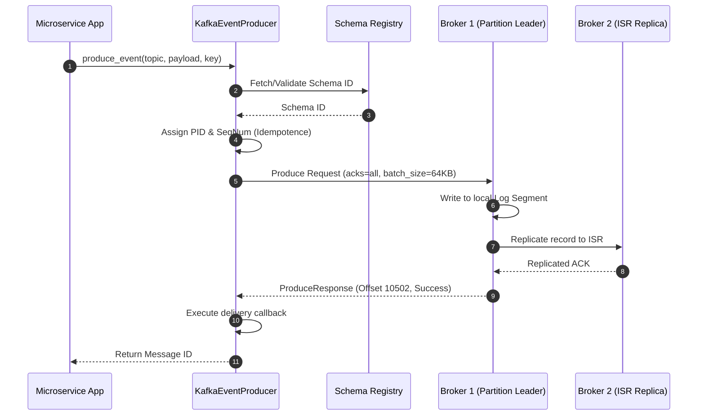
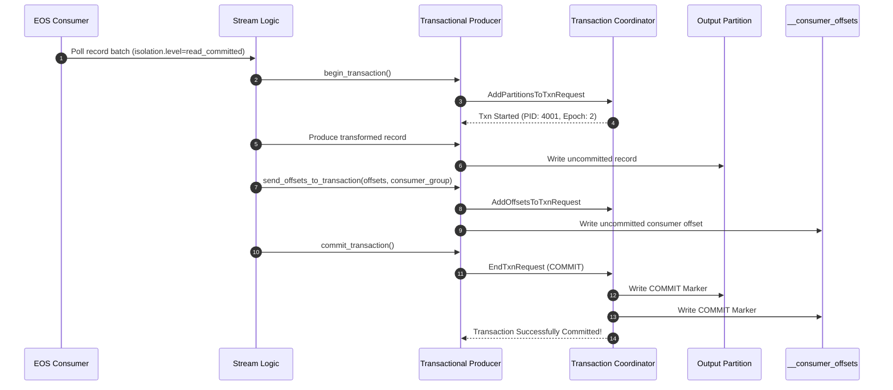
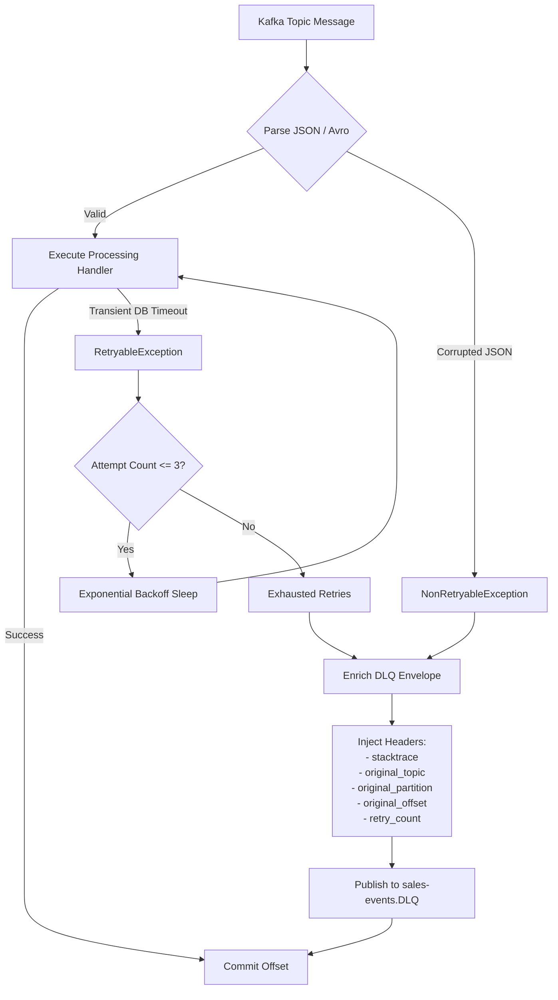

# 🏗️ Enterprise Architecture Design: Apache Kafka Real-Time Event Streaming Pipeline

> **Data Engineering Diaries** | Project 09: Apache Kafka for Real-Time Data Engineering  
> Author: Sathiya Murthy

---

## 1. High-Level Streaming Architecture

```mermaid
graph TB
    subgraph EventProducers["⚡ Data Ingestion Layer (Producers)"]
        P1["Checkout Microservice\n(Sales Events)"]
        P2["Mobile & Web Apps\n(Clickstream Events)"]
        P3["Industrial IoT Sensors\n(Telemetry)"]
        P4["Debezium CDC\n(PostgreSQL WAL Tailing)"]
    end

    subgraph SchemaGov["🛡️ Data Governance"]
        SR["Confluent Schema Registry\n(Avro Schema Contracts)"]
    end

    subgraph KafkaCluster["🟠 Apache Kafka Production Cluster (3 Brokers)"]
        subgraph Broker1["Broker 1 (Node 101)"]
            B1_T1P0["sales-events: P0 (Leader)"]
            B1_T1P1["sales-events: P1 (ISR)"]
            B1_T2P0["user-clicks: P0 (Leader)"]
            B1_T3P1["iot-readings: P1 (ISR)"]
        end

        subgraph Broker2["Broker 2 (Node 102)"]
            B2_T1P1["sales-events: P1 (Leader)"]
            B2_T1P2["sales-events: P2 (ISR)"]
            B2_T2P1["user-clicks: P1 (Leader)"]
            B2_T3P0["iot-readings: P0 (Leader)"]
        end

        subgraph Broker3["Broker 3 (Node 103)"]
            B3_T1P2["sales-events: P2 (Leader)"]
            B3_T1P0["sales-events: P0 (ISR)"]
            B3_T2P2["user-clicks: P2 (Leader)"]
            B3_T3P2["iot-readings: P2 (Leader)"]
        end

        KRaft["KRaft / ZooKeeper\n(Quorum Controller)"]
    end

    subgraph Consumers["👥 Consumer Layer & Processing Pipelines"]
        subgraph StreamProc["Real-Time Stream Processors"]
            SP1["StreamProcessor Pod 1\n(Tumbling Window Aggregations)"]
            SP2["StreamProcessor Pod 2\n(Threshold Alerting)"]
        end

        subgraph EOSProc["Exactly-Once Processor"]
            EOS["Transactional Processor\n(isolation.level=read_committed)"]
        end
    end

    subgraph Downstream["🏁 Downstream Storage & Analytics Sinks"]
        Snowflake["Snowflake Data Warehouse\n(Snowflake Sink Connector)"]
        S3["AWS S3 Data Lake\n(Parquet Partitioned Sink)"]
        DLQ["Dead Letter Queue Topic\n(sales-events.DLQ)"]
        Alerts["PagerDuty / Slack Alerts"]
    end

    P1 -->|JSON/Avro (acks=all)| B1_T1P0
    P2 -->|Click Events| B1_T2P0
    P3 -->|Telemetry| B2_T3P0
    P4 -->|Debezium Envelopes| B2_T1P1

    P1 <--->|Register / Fetch Schema| SR
    SP1 <--->|Validate Schema| SR

    B1_T1P0 --> SP1
    B2_T1P1 --> SP2
    B3_T1P2 --> EOS

    SP1 --> Snowflake
    SP2 --> Alerts
    EOS --> S3
    SP1 -.->|Unrecoverable Poison Message| DLQ

    classDef kafka fill:#ff9900,stroke:#333,stroke-width:2px,color:#fff;
    classDef producer fill:#0066cc,stroke:#333,stroke-width:2px,color:#fff;
    classDef sink fill:#009933,stroke:#333,stroke-width:2px,color:#fff;
    class KafkaCluster,Broker1,Broker2,Broker3 kafka;
    class Producers,P1,P2,P3,P4 producer;
    class Downstream,Snowflake,S3 sink;
```

---

## 2. Topic Partitioning & Broker Placement Strategy

### Topic Topology Table

| Topic Name | Partitions | Replication Factor | Min In-Sync Replicas (min.insync.replicas) | Retention Policy | Retention Period | Cleanup Policy |
|---|---|---|---|---|---|---|
| `sales-events` | 6 | 3 | 2 | Delete | 7 Days (`604800000 ms`) | `delete` |
| `user-clicks` | 3 | 3 | 2 | Delete | 3 Days (`259200000 ms`) | `delete` |
| `iot-readings` | 12 | 3 | 2 | Delete | 1 Day (`86400000 ms`) | `delete` |
| `cdc-user-updates` | 3 | 3 | 2 | Compact | Indefinite | `compact` |
| `sales-events.DLQ` | 3 | 3 | 2 | Delete | 14 Days (`1209600000 ms`)| `delete` |

---

## 3. Producer Delivery Guarantee Pipeline



---

## 4. Exactly-Once Processing (EOS) 2-Phase Commit Architecture



---

## 5. Dead Letter Queue (DLQ) & Fault Tolerance Pattern



---

## 6. Security & Encryption Standards

1. **Transport Layer Security (TLS 1.3)**: All broker-to-client and inter-broker communication encrypted via TLS.
2. **Authentication (SASL/SCRAM-SHA-512)**: Credentials authenticated with encrypted SCRAM tokens.
3. **Authorization (Kafka ACLs)**: Fine-grained Topic Access Control Lists:
   - Producers: `WRITE`, `DESCRIBE` on specific topic prefix.
   - Consumers: `READ`, `DESCRIBE` on specific consumer group and topics.
