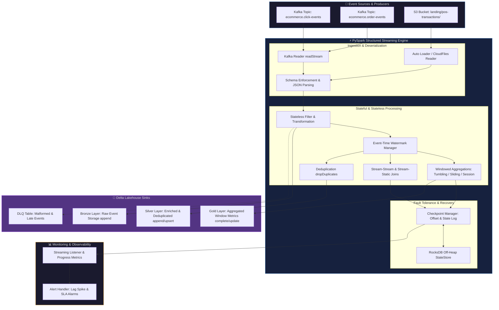

# Architecture Design: PySpark Structured Streaming & Kafka Lakehouse

> **Data Engineering Diaries** | Real-Time Event Driven Streaming Architecture

---

## 1. System Architecture Overview

This enterprise streaming architecture handles unbounded, low-latency event ingestion from Apache Kafka and Cloud Object Storage (S3 / ADLS / GCS), transforming incoming event micro-batches using PySpark Structured Streaming, and persisting transactional data into Delta Lake Medallion storage layers.



---

## 2. Ingestion & Sources

### Kafka Source (`readStream.format("kafka")`)
- **Partitioning Alignment**: Spark creates one RDD task per Kafka topic partition per micro-batch.
- **Offset Management**: Source offsets are tracked per partition in Spark checkpoint logs (`/checkpoints/offsets/`).
- **Backpressure Control**: `maxOffsetsPerTrigger` limits the maximum number of Kafka messages consumed per micro-batch, preventing executor memory exhaustion during traffic spikes.

### File Source / Databricks Auto Loader (`cloudFiles`)
- **Event-Driven Detection**: Uses S3 EventBridge / Azure Event Grid file notifications instead of expensive directory listing calls.
- **Schema Evolution**: Automatically handles column additions and type widening without breaking stream execution.

---

## 3. Watermarking & State Management

### Watermark Mathematics
A watermark is defined as:
$$\text{Watermark}_N = \max(\text{EventTime}_N) - \text{DelayThreshold}$$

```
Micro-Batch N Execution:
─────────────────────────────────────────────────────────────────────────────
Received Events Max Timestamp : 10:20:00
Configured Watermark Delay     : 15 minutes
Calculated Watermark Threshold : 10:05:00

Action:
- Events with event_time >= 10:05:00 → Processed & updated in StateStore.
- Events with event_time < 10:05:00  → Dropped as LATE DATA (or routed to DLQ).
─────────────────────────────────────────────────────────────────────────────
```

### StateStore Architecture: RocksDB vs HDFSBacked
- **HDFSBacked StateStore (Default)**: Keeps state in JVM heap memory. Causes Java Garbage Collection (GC) pauses when state exceeds tens of millions of keys.
- **RocksDB StateStore (Production Standard)**: Stores state off-heap in native memory and local SSD disks, checkpointing state deltas asynchronously to cloud storage (S3/ADLS).

---

## 4. End-to-End Exactly-Once Semantics

Structured Streaming achieves **End-to-End Exactly-Once Processing** by combining three guarantees:

1. **Replayables Source**: Kafka offset seek / Cloud Storage file log allows re-reading specific event ranges on failure.
2. **Deterministic Processing**: Re-executing a micro-batch with the same offsets yields identical result rows.
3. **Idempotent / Atomic Sink**: Delta Lake ACID transaction log (`_delta_log/`) commits micro-batch files atomically. Duplicate batch execution writes identical files, but Delta discards uncommitted attempts.

---

## 5. Medallion Storage Pattern

| Layer | Sink Format | Mode | Purpose |
|---|---|---|---|
| **Bronze** | Delta Lake | `append` | Raw event archive preserving full payload, source file/topic metadata, and ingestion timestamp. |
| **Silver** | Delta Lake | `append` / `foreachBatch` MERGE | Parsed, normalized, deduplicated, and enriched streaming records. |
| **Gold** | Delta Lake | `complete` / `update` | Real-time aggregated business KPIs, tumbling/sliding window metrics. |
| **DLQ** | Delta Lake | `append` | Malformed JSON rows, unparseable payloads, or severely late data. |
