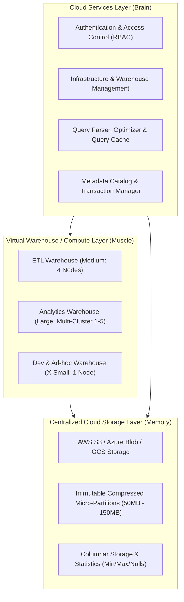
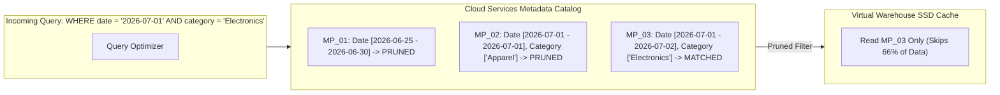
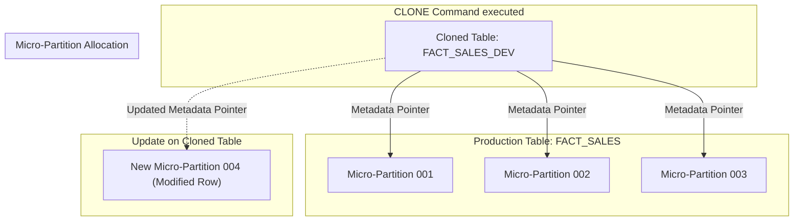
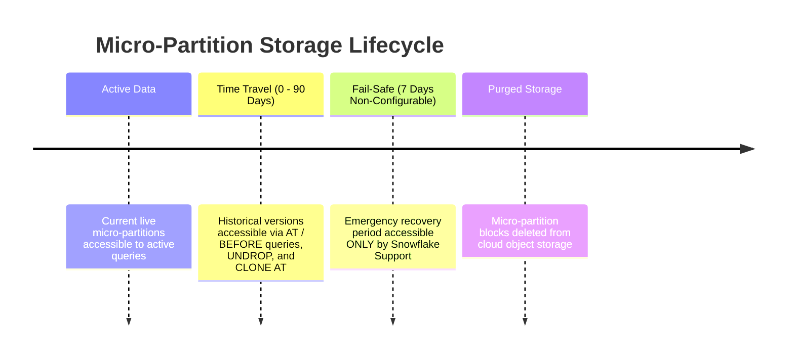
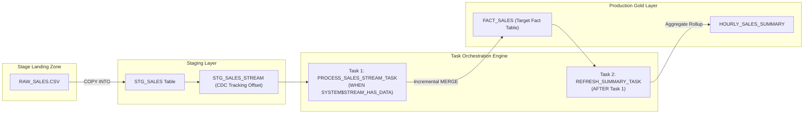
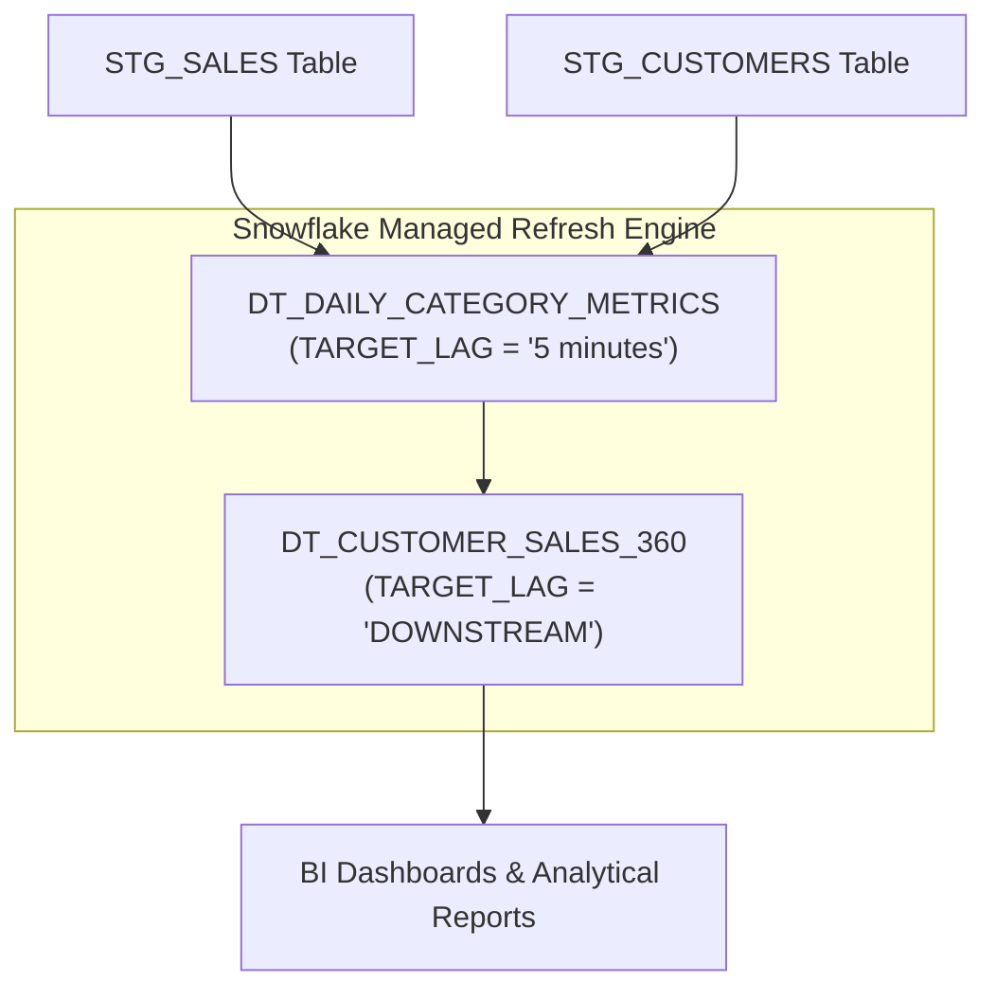
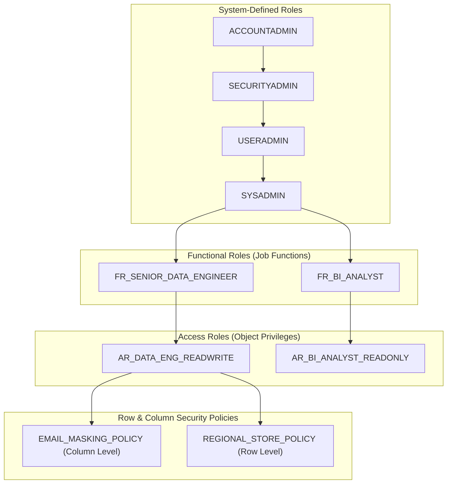

# System Architecture: Snowflake Cloud Data Warehousing

This document presents the detailed architectural design of Snowflake's multi-cluster shared-data cloud warehouse architecture, micro-partition layout, zero-copy cloning, time travel mechanics, streams & tasks execution engine, declarative dynamic tables, and enterprise governance framework.

---

## 1. High-Level 3-Layer Architecture Overview

Snowflake decouples compute, storage, and cloud management into three independent layers. This architecture guarantees that storage scales independently of compute, eliminating traditional resource contention.

### Layer Details:
1. **Cloud Services Layer**: Coordinates all account operations—authentication, role-based access control, query parsing, transaction management, micro-partition metadata tracking, and automatic metadata caching.
2. **Virtual Warehouse (Compute) Layer**: Consists of MPP (Massively Parallel Processing) compute clusters allocated on demand. Warehouses pull micro-partitions from storage into local SSD caches for rapid processing.
3. **Centralized Storage Layer**: Object storage (S3/Azure Blob/GCS) storing all data as immutable columnar micro-partitions.

---

## 2. Micro-Partitioning & Pruning Engine

Data in Snowflake tables is automatically partitioned into contiguous, immutable micro-partitions (50MB to 150MB uncompressed).

### Key Properties:
- **Automatic Partitioning**: No manual partition maintenance or path specification needed.
- **Columnar Storage**: Columns within micro-partitions are stored separately and compressed using algorithm selection (LZ4, ZSTD).
- **Partition Metadata**: Min/max ranges, distinct counts, and null counts stored in Cloud Services allow 95%+ partition pruning prior to reading data blocks.

---

## 3. Zero-Copy Cloning Architecture

Zero-copy cloning duplicates tables, schemas, or entire databases instantly by creating new metadata references pointing to existing immutable micro-partitions.

### Operational Characteristics:
- **Zero Cost at Creation**: Takes milliseconds to execute regardless of dataset size; incurs zero additional storage costs initially.
- **Divergent State**: Modifications to the clone write new micro-partitions without altering the source table partitions.

---

## 4. Time Travel & Fail-Safe Lifecycle

Snowflake provides automatic data protection across table lifecycles through Time Travel and Fail-Safe periods.

### Table Type Comparison Matrix:

| Feature / Metric | Permanent Tables | Transient Tables | Temporary Tables |
| :--- | :--- | :--- | :--- |
| **Default Scope** | Account-wide persistent | Account-wide persistent | Session-only lifetime |
| **Max Time Travel** | Up to 90 Days | 1 Day max | 1 Day max |
| **Fail-Safe Period** | 7 Days (Non-configurable) | 0 Days (No Fail-Safe) | 0 Days (No Fail-Safe) |
| **Fail-Safe Cost** | Yes | No | No |
| **Primary Use Case** | Production Fact/Dim Tables | High-churn Staging Tables | Ephemeral Script Scratchpads |

---

## 5. Streams & Tasks CDC Processing Pipeline

Change Data Capture (CDC) pipelines combine Streams to record row deltas and Tasks to automate execution.

---

## 6. Declarative Continuous Pipelines with Dynamic Tables

Dynamic Tables automate complex data transformation DAGs declaratively based on target lag parameters.

---

## 7. Role-Based Access Control (RBAC) & Governance Architecture

Snowflake security decouples privileges into Access Roles and Functional Roles, combined with row/column policies.

