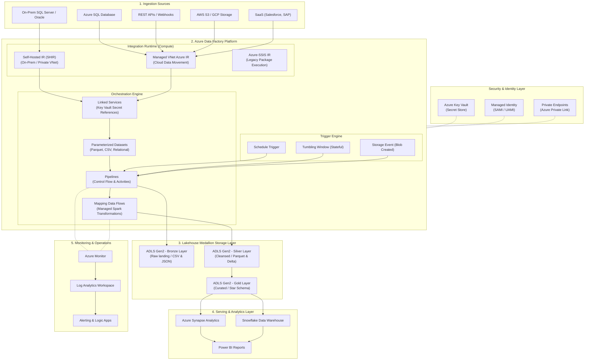
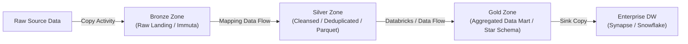
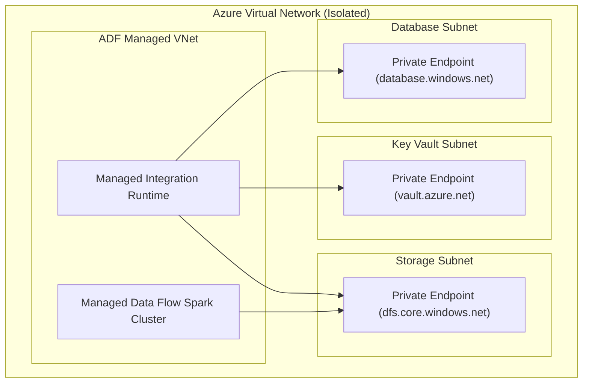
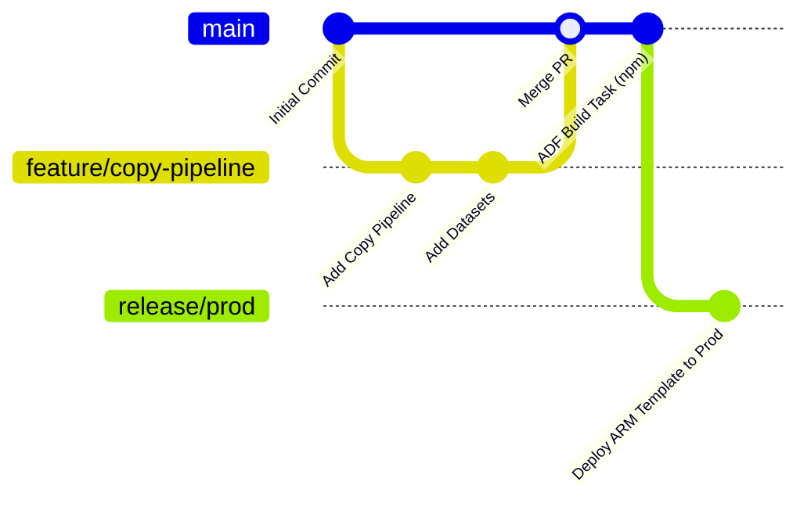

# Architecture Design: Azure Data Factory Ingestion & Integration Platform

> **Data Engineering Diaries** | Cloud-Native Enterprise Data Architecture with Azure Data Factory (ADF)

---

## 1. Executive Summary

Azure Data Factory (ADF) serves as the core orchestration and data movement engine for modern cloud data platforms on Microsoft Azure. It unifies hybrid data sources across on-premise systems, multi-cloud platforms (AWS, GCP, Snowflake), and SaaS applications into a centralized, governed Data Lakehouse ecosystem.

This document outlines the production architecture, security posture, Integration Runtime topology, CI/CD pipeline, and operational monitoring strategy for building scalable ADF data integration solutions.

---

## 2. Platform Architecture Diagram

---

## 3. Core Architectural Components

### 3.1 Integration Runtime (IR) Selection Strategy

The Integration Runtime is the compute infrastructure providing the execution environment for ADF activities.

| IR Type | Deploy Environment | Connectivity | Primary Use Case | Cost Model |
|---|---|---|---|---|
| **Azure IR (Standard)** | Fully Managed Cloud | Public Internet | Cloud-to-Cloud data copy & pipeline control activities | Pay-per-DIU-hour |
| **Azure IR (Managed VNet)** | Isolated VNet | Private Endpoints | Secure cloud ingestion without exposing public endpoints | Pay-per-DIU + VNet runtime |
| **Self-Hosted IR (SHIR)** | On-Prem VM / IaaS VM | On-Prem Network / ExpressRoute | Ingesting legacy databases (Oracle, DB2, SQL Server) behind corporate firewalls | Self-managed VM compute cost |
| **Azure-SSIS IR** | Managed VM Cluster | VNet Integration | Migrating legacy SQL Server Integration Services (SSIS) packages to Azure | Hourly cluster node pricing |

---

## 4. Medallion Storage Integration Pattern

ADF pipelines orchestrate data movement through the enterprise **Medallion Architecture**:

1. **Bronze Layer (Raw Landing):**
   - Ingested as-is from source systems.
   - Storage format: Raw CSV, JSON, ORC, Binary.
   - Folder structure: `/bronze/{source_system}/{table_name}/yyyy/MM/dd/`.
2. **Silver Layer (Cleansed & Standardized):**
   - Data cleansing, data type enforcement, null checks, deduplication.
   - Storage format: Compressed Parquet or Delta Lake format.
   - Managed via ADF Mapping Data Flows or Azure Databricks activities.
3. **Gold Layer (Curated Analytical Layer):**
   - Business aggregations, dimensional modeling (Fact and Dimension tables), KPI calculations.
   - Served directly to Power BI or loaded into Snowflake / Synapse Analytics.

---

## 5. Security & Network Topology

### Security Best Practices
- **Zero Secrets in Code:** All database passwords, API tokens, and connection strings are stored in Azure Key Vault. Linked services reference Key Vault secrets using `@activity()` or native secret pointers.
- **System-Assigned Managed Identity (SAMI):** ADF authenticates to ADLS Gen2, Azure SQL, and Azure Key Vault via SAMI, avoiding service principal secret expiration issues.
- **Network Isolation:** Public network access is disabled (`publicNetworkAccess: Disabled`). Data movement flows strictly across Managed Private Endpoints over the Microsoft backbone network.

---

## 6. CI/CD Architecture & Deployment Pipeline

1. **Development:** Engineers build and test pipelines in ADF Git-integrated dev instances using feature branches.
2. **Pull Request & Merge:** Merging to the `main` branch triggers the **ADF Build Task** (`@microsoft/azure-data-factory-utilities` npm package) to validate and generate ARM templates (`ARMTemplateForFactory.json`).
3. **Automated Deployment:** Azure DevOps or GitHub Actions deploys the generated ARM template to Staging and Production environments using environment-specific parameter overrides (`ARMTemplateParametersForFactory.json`).

---

## 7. Monitoring & Operational Governance

- **Diagnostic Logs:** Configured to push all `PipelineRuns`, `ActivityRuns`, and `TriggerRuns` to an Azure Log Analytics Workspace.
- **Operational Alerts:** Azure Monitor Alert rules fire webhooks to Azure Logic Apps on pipeline failure, delivering formatted Slack/Teams notifications and PagerDuty incidents.
- **SLA Enforcement:** Pipeline and activity-level `timeout` properties abort hanging executions to ensure SLAs are met.
