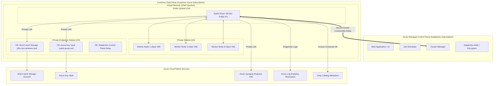
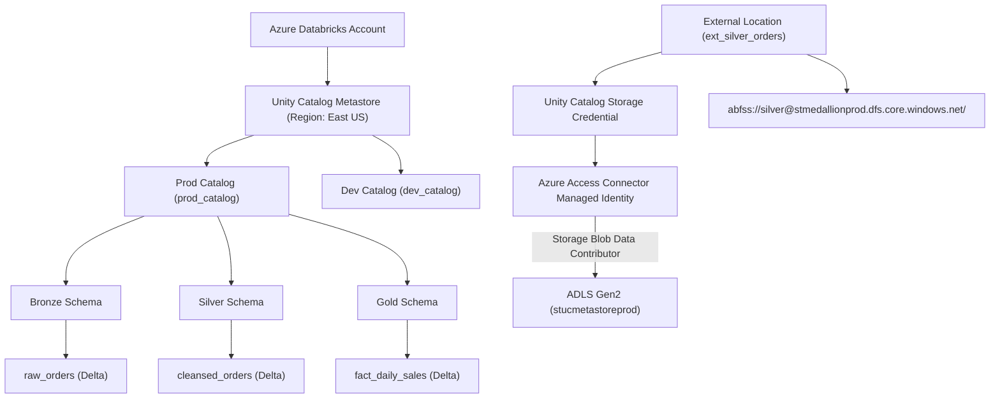
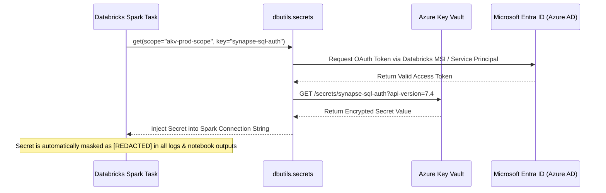

# Azure Databricks Architecture & Enterprise Security Topology

## 1. System Topology & Dual-Plane Architecture

Azure Databricks operates on a decoupled architecture split into two key planes:
1. **Control Plane**: Managed by Microsoft and Databricks in Azure system subscriptions. Contains web application interface, notebook management, cluster manager service, job scheduler, and metadata catalog.
2. **Data Plane**: Runs inside the customer's Azure Subscription. Contains the virtual machines (driver and executor worker nodes), local SSD caches, virtual networks (VNet), and direct network routes to storage services.

---

## 2. VNet Injection & Network Isolation

### VNet Injection Specification
In enterprise deployments, standard Databricks default VNets are replaced by **VNet Injection**, placing all Databricks compute nodes in customer-managed virtual networks.

- **VNet Address Space**: e.g., `10.178.0.0/16`
- **Host Subnet (Public Subnet)**: `10.178.0.0/24` — Contains driver host processes. Delegated to `Microsoft.Databricks/workspaces`.
- **Container Subnet (Private Subnet)**: `10.178.1.0/24` — Contains container runtime worker executors. Delegated to `Microsoft.Databricks/workspaces`.
- **Private Endpoint Subnet**: `10.178.2.0/24` — Hosts Network Interfaces (NICs) for Private Link connections.

### Secure Cluster Connectivity (No Public IP / NPIP)
When **No Public IP (NPIP)** mode is enabled:
1. Virtual machines provisioned in the Data Plane have **zero public IP addresses** attached.
2. Inbound public internet ports (e.g. SSH, HTTP 80/443) are completely closed.
3. Outbound communication to the Control Plane is established via an encrypted Secure Cluster Connectivity (SCC) relay tunnel initiated from inside the VNet.

---

## 3. Unity Catalog Governance Topology on Azure

Azure Unity Catalog provides account-level centralized data governance across all Databricks workspaces within an Azure region.

### Key Security Components
1. **Access Connector for Azure Databricks**: An Azure first-party resource containing a System-Assigned or User-Assigned Managed Identity.
2. **Storage Credential**: A Unity Catalog object encapsulating the Access Connector resource ID.
3. **External Location**: Combines an ADLS Gen2 `abfss://` container URI with a Storage Credential to define governed physical storage paths.
4. **Attribute-Based Access Control (ABAC)**: Grants granular privileges (`SELECT`, `MODIFY`, `CREATE TABLE`) directly to Entra ID (Azure AD) user groups.

---

## 4. Key Vault Secret Management Flow

All credentials (database connections, service principal keys, third-party API tokens) are strictly stored inside Azure Key Vault and projected into Databricks using AKV-backed Secret Scopes.

---

## 5. Enterprise High Availability & Disaster Recovery (HADR)

For mission-critical production data engineering platforms:
- **Active-Passive Multi-Region Topology**: Primary workspace in `East US`, secondary disaster recovery workspace in `Central US`.
- **Storage Replication**: ADLS Gen2 containers configured with Read-Access Geo-Redundant Storage (RA-GRS) or Object Replication.
- **Infrastructure as Code (IaC)**: Terraform / Bicep automation templates ensure identical VNet, cluster policy, and secret scope deployment in secondary region.
- **Databricks Asset Bundles (DABs)**: CI/CD pipelines automate target switching between regions upon failover.
