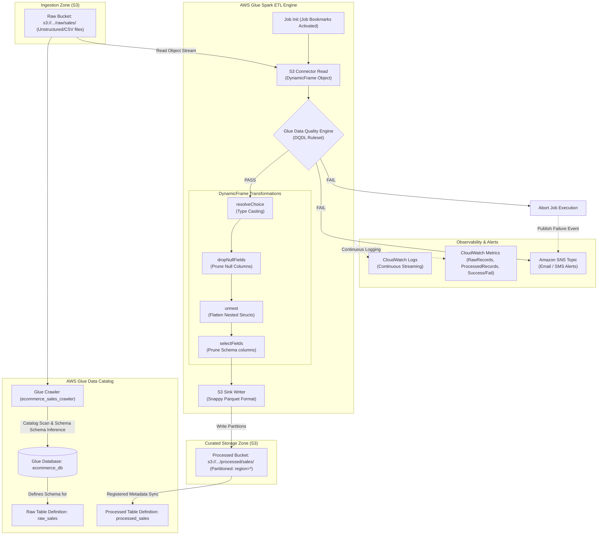

# System Architecture: AWS Glue Serverless ETL & Cataloging Pipeline

This document describes the architectural framework, component interactions, and data lifecycle flow for the AWS Glue serverless ETL pipeline.

## System Component Diagram

The following Mermaid diagram visualizes the flow of data from ingestion to storage, detailing how crawlers, catalog metadata, Glue ETL jobs, validation rules, and monitoring systems interface.

## Step-by-Step Data Flow

1. **Ingestion Trigger / S3 Upload**:
   Raw transactional CSV records are loaded into the target S3 prefix (`s3://data-engineering-diaries-glue-demo/raw/sales/`).
2. **Metadata Discovery & Cataloging**:
   - The **Glue Crawler** (`ecommerce_sales_crawler`) runs scheduled (daily) or on-demand.
   - It crawls the raw directory, determines file structure, infers types, and registers/updates the database schema definitions inside the **Glue Data Catalog** database `ecommerce_db` under table name `raw_sales`.
3. **ETL Compute Bootstrapping**:
   - The **AWS Glue ETL Job** is triggered via a Workflow or On-Demand.
   - It boots up a Spark-managed serverless environment with selected workers (`G.1X` workers).
   - `Job Bookmarks` are loaded. The bookmark registers which files in the raw prefix have already been consumed by previous successful job runs to guarantee incremental ingestion.
4. **Data Validation (DQDL Engine)**:
   - The raw files are loaded into an AWS Glue `DynamicFrame` object.
   - The **AWS Glue Data Quality (DQDL)** ruleset runs. If validations pass, the pipeline continues. If validation fails, metrics are written to S3, a notification is sent to Amazon SNS, and the job aborts.
5. **Schema Alignment & Transform**:
   - `resolveChoice` converts column types (e.g. string fields like `revenue` and `discount` cast to `double`).
   - `dropNullFields` drops columns that contain no data.
   - `unnest` flattens nested columns.
   - `selectFields` ensures only required columns remain in the output schema.
6. **Partitioned Parquet Sink Write**:
   - The transformed data is written back to S3 under `s3://data-engineering-diaries-glue-demo/processed/sales/` in **Snappy Parquet** format.
   - It is partitioned by `region`, producing folders like `region=North/`, `region=South/` etc.
7. **Job State Update**:
   - The job commits the Job Bookmark state, marking the files as processed.
   - Custom metrics (record counts, execution duration) are published to CloudWatch metrics.
