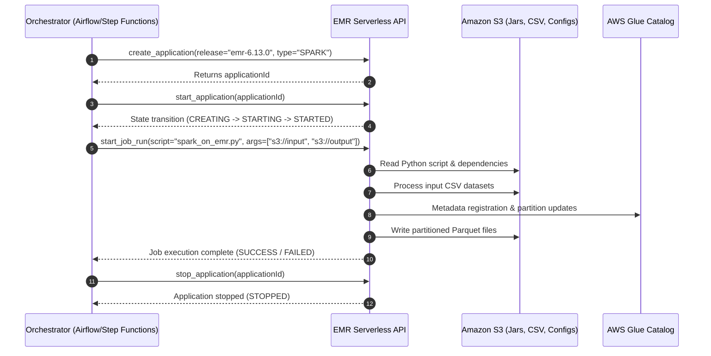

# EMR Distributed Architecture & Data Flow

This document details the architectural design and structural patterns for Amazon EMR clusters (EC2-based) and EMR Serverless environments used in this project.

---

## 1. Amazon EMR on EC2 Cluster Architecture

An Amazon EMR cluster is a collection of Amazon EC2 instances. Each instance is called a **node** and has a specific role within the cluster topology.

```mermaid
graph TD
    subgraph Client Layer
        orchestrator[Airflow / Step Functions]
        boto3_client[EMR Boto3 Client]
    end

    subgraph Amazon EMR Cluster (EC2)
        direction TB
        
        subgraph Primary Node [Master Node - Active/Standby]
            yarn_rm[YARN ResourceManager]
            hdfs_nn[HDFS NameNode]
            spark_driver[Spark Driver]
            ganglia[Ganglia / Monitoring]
        end

        subgraph Core Node Fleet [HDFS Storage + Compute]
            yarn_nm_core[YARN NodeManager]
            hdfs_dn_core[HDFS DataNode]
            spark_exec_core[Spark Executors]
        end

        subgraph Task Node Fleet [Compute Only - Spot Instances]
            yarn_nm_task[YARN NodeManager]
            spark_exec_task[Spark Executors]
        end
    end

    subgraph Storage & Catalog Layer
        s3_data[(Amazon S3 - Data Lake)]
        s3_logs[(Amazon S3 - EMR Logs)]
        glue_catalog[AWS Glue Data Catalog]
    end

    %% Client Interactions
    orchestrator -->|Trigger / Poll| boto3_client
    boto3_client -->|Launch & Add Steps| PrimaryNode
    
    %% Internal Cluster Routing
    PrimaryNode -->|Orchestrate Jobs| CoreNodeFleet
    PrimaryNode -->|Scale-Out Tasks| TaskNodeFleet
    
    %% Storage access
    CoreNodeFleet <-->|Local Cache / HDFS| hdfs_dn_core
    CoreNodeFleet -->|Read/Write EMRFS| s3_data
    TaskNodeFleet -->|Read/Write EMRFS| s3_data
    PrimaryNode -->|Sync Schema| glue_catalog
    PrimaryNode -->|Export Logs| s3_logs
```

### Node Topologies
1. **Primary Node (Master)**: Coordinates the cluster, executes the Spark Driver, runs the Hadoop YARN ResourceManager, and hosts the NameNode daemon.
2. **Core Nodes**: Run Hadoop HDFS DataNode daemons and YARN NodeManagers. They participate in computing and also store data locally within HDFS.
3. **Task Nodes**: Run YARN NodeManagers only. They handle distributed Spark task executions but do **not** write data to local HDFS, making them completely stateless. Because of their stateless nature, they are ideal for **Spot Instances**; if AWS reclaims a Spot Task node, the job continues without HDFS block degradation or data loss.

---

## 2. EMR Serverless Execution Flow

EMR Serverless removes the overhead of managing EC2 clusters. You define a Spark application and submit jobs directly, and AWS handles provisioning, auto-scaling, and termination.



---

## 3. Storage Layer Integration (EMRFS vs HDFS)

In enterprise data pipelines, EMRFS is preferred over standard HDFS.

| Metric | HDFS (Hadoop Distributed File System) | EMRFS (EMR File System on S3) |
| :--- | :--- | :--- |
| **Storage Medium** | Local Instance Store / EBS Volumes | Amazon S3 |
| **Persistence** | Lost when cluster is terminated. | Persistent. Independent of cluster lifecycles. |
| **Scaling** | Tight coupling: scaling storage requires buying more compute. | Decoupled: scale storage in S3, scale compute in EMR. |
| **Cost** | High (paying for active EC2 nodes to keep disks online). | Low (S3 standard storage pricing). |
| **Metadata** | Tracked by local NameNode. | Direct S3 mapping; Optional Glue Data Catalog synchronization. |

---

## 4. Resource Manager & Scheduling (YARN)

YARN (Yet Another Resource Negotiator) manages the cluster resources:
- **ResourceManager**: Runs on the primary node and acts as the ultimate authority for resource allocation.
- **NodeManager**: Runs on Core and Task nodes, monitors containers, and reports resource utilization to the ResourceManager.
- **CapacityScheduler**: Configured in `yarn-site` to share cluster resources among multiple Spark jobs and queues.
