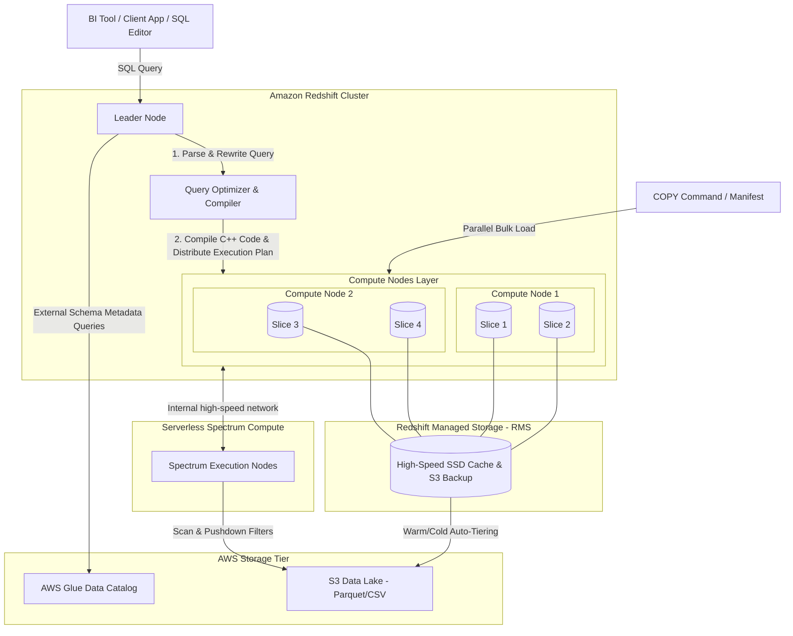

# Amazon Redshift Architecture

This document describes the Massively Parallel Processing (MPP) architecture of Amazon Redshift, outlining data flow, compute slice division, query planning, storage layers, and data lake integrations.

---

## 1. Architectural Component Map

---

## 2. Key Architecture Components

### A. Leader Node
The **Leader Node** manages external communications and coordinates all execution processes:
- **Query Parsing & Rewriting:** Parses SQL statements, evaluates syntax, and matches query definitions with materialized views (automated query rewriting).
- **Execution Code Generation:** Compiles queries into optimized C++ executable code segments (instead of interpreting them row-by-row), sending them to compute nodes.
- **Result Aggregation:** Receives partial datasets from compute nodes, performs final aggregations or sorting, and returns results back to the client application.
- **WLM (Workload Management):** Assigns queries to queues based on configuration rules.

### B. Compute Nodes & Slices
Compute nodes execute compiled C++ queries in parallel:
- **Massively Parallel Processing (MPP):** Nodes partition the database tables across high-performance **Slices**.
- **Compute Slices:** Each compute node is partitioned into slices. Slices process their portion of the table data in parallel, communicating over a dedicated internal 10Gbps network.
- **Hardware Profile:** Slices get dedicated shares of the node’s CPU, memory, and disk space.

### C. Redshift Managed Storage (RMS)
Redshift modern RA3 instances separate compute from storage:
- **Local Cache:** High-performance SSDs act as local cache for frequently queried blocks.
- **S3 Durability:** S3 is used as the backing storage layer. If local cache hits a miss, blocks are fetched on demand from S3.
- **Auto-tiering:** Cold/older blocks are automatically evicted from local SSDs to S3, while warm/hot blocks are kept local.

### D. Redshift Spectrum
**Redshift Spectrum** runs queries directly against unstructured or structured files in S3 without loading them:
- **Serverless Compute:** Runs scans on a shared serverless compute pool separate from the cluster.
- **Glue Integration:** Relies on AWS Glue Catalog metadata schemas to define external tables.
- **Query Pushdowns:** Resolves group-by, projections, and filters inside the Spectrum layer before sending condensed datasets back to the local Redshift cluster.
