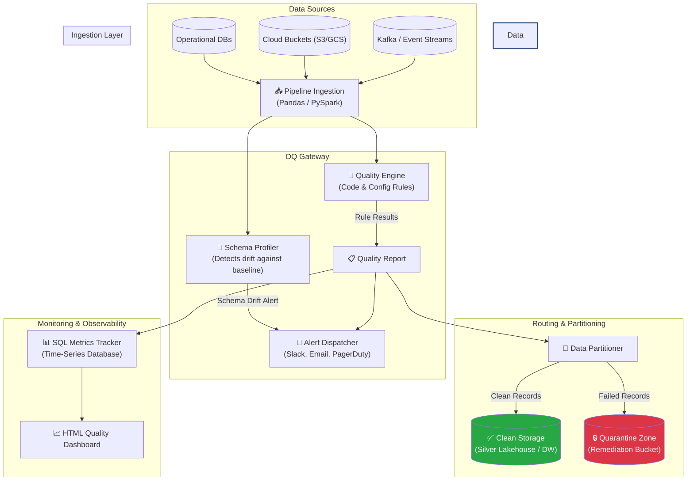

# 🏗️ Architecture Design: Data Quality & Validation Frameworks

This document details the architecture of the **Enterprise Data Quality Framework** designed for production data pipelines. It explains how raw data ingestion flows through our validation engine, profiles for schema and statistical drift, partitions bad data to prevent corruption, and tracks and alerts on historical trends.

---

## 1. System Architecture Overview

The framework operates as an inline gatekeeper within data pipelines. It intercepts incoming batch or stream datasets immediately after ingestion and validates them before they can reach the primary data store (Data Warehouse/Lake).

---

## 2. Core Architectural Components

### A. Quality Rule Registry & Engine (`src/dq_framework/`)
- **`QualityRule` (Base Class)**: Standardizes rules across six data quality dimensions (Completeness, Uniqueness, Validity, Consistency, Timeliness, Accuracy). Every rule evaluates against a DataFrame and returns a `RuleResult` with details on failed row indices and counts.
- **`RuleRegistry`**: A decorator-driven registry mapping config identifiers (e.g. `"validity_email"`) to specific rule classes. This enables decoupling configuration from code.
- **`QualityEngine`**: Instantiates rules from a central YAML config and orchestrates their execution against target datasets. It then splits clean data from quarantined data.

### B. In-Line Partitioning & Quarantine Zone (`src/dq_framework/quality_engine.py`)
- Rules are classified by **Severity** (`CRITICAL`, `ERROR`, `WARNING`, `INFO`).
- Row indices flagged by rules with `CRITICAL` or `ERROR` severities are collected into a global exclusion set.
- The dataset is split into:
  1. **Clean Dataset**: Passed records. Clean files are written to production storage.
  2. **Quarantine Dataset**: Failed records. Saved as separate audit files in a quarantine bucket for remediation, preventing downstream failures.

### C. Schema and Statistical Profilers (`src/profiling/`)
- **`SchemaProfiler`**: Implements drift detection. It checks incoming DataFrame columns and types against a locked **baseline schema** definition and raises alerts if unexpected columns appear or expected columns are modified.
- **`StatisticalProfiler`**: Analyzes statistical properties (min, max, mean, skewness, kurtosis) and correlation matrices, signaling anomalies when values drift from statistical thresholds (e.g. standard deviation deviations).

### D. Observability & Alerting Engine (`src/monitoring/`)
- **`DQMetricsTracker`**: Saves time-series quality metrics to an SQLite database. It records row counts, rule status, and failure frequencies, enabling tracking over time.
- **`DQAlertDispatcher`**: A modular alerting dispatcher that sends notifications to Slack webhooks, email lists, or operations centers when validation reports return `FAILED` status.
- **`DQDashboard`**: Compiles reports into bootstrap-themed standalone HTML pages for visual reporting.

---

## 3. Execution Data Flow

1. **Trigger**: Pipeline receives an incoming dataset.
2. **Profile**: Schema is checked for drift. If drift is detected, a schema warning is logged and an alert is dispatched.
3. **Execute Rules**: `QualityEngine` runs all configured rules.
4. **Collect Metrics**: Rule outcomes (passes, failures, sample bad rows) are formatted into a `QualityReport`.
5. **Partition**: If `FAILED`, rows violating validation are quarantined.
6. **Persist & Alert**: Metrics are committed to the historical SQLite DB. If failures exceed thresholds, the alerting pipeline is triggered.
7. **Report**: An HTML dashboard is compiled and saved.
