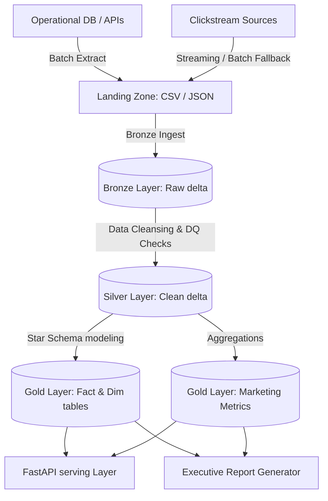

# DataMart Global Platform Architecture

This document describes the architectural layers and data flow within the DataMart Global capstone platform.

---

## 1. System Components

* **Ingestion Layer:**
  * **Events Producer:** Streams clickstream events (JSON) to Kafka.
  * **Orders Extractor:** Copies operational orders (CSV) to the landing zone.
  * **REST API Extractor:** Mocks customer profile updates.
  * **Catalog Loader:** Uploads the product inventory updates.

* **Storage Layer (Medallion Architecture):**
  * **Landing Zone:** Raw files landing folder.
  * **Bronze:** Appends raw files and streams, injecting ingestion metadata (`_ingested_at`, `_source_file`).
  * **Silver:** Performs data cleansing, type casting, deduplication, and quality validations.
  * **Gold:** Computes business metrics (Facts and Dimensions) formatted for analytical queries.

* **Serving & Operational Layer:**
  * **FastAPI serving:** Exposes endpoints to query Gold tables.
  * **Report Generator:** Formats executive performance dashboards in Markdown.
  * **Alerting Service:** Dispatches slack alerts on failure states.

---

## 2. Data Flow Architecture

The end-to-end data pipeline follows a structured, daily execution flow managed by the orchestrator:

---

## 3. Technology Stack & Scalability
* **Spark Streaming & Delta Lake:** Used to scale storage and compute across multi-node clusters.
* **dbt (data build tool):** Compiles queries into the target database.
* **Apache Airflow:** Orchestrates task execution pipelines.
* **FastAPI:** Exposes metrics to downstream applications.
* **Telemetry CSV Storage:** Tracks pipeline costs and performance metrics locally.
