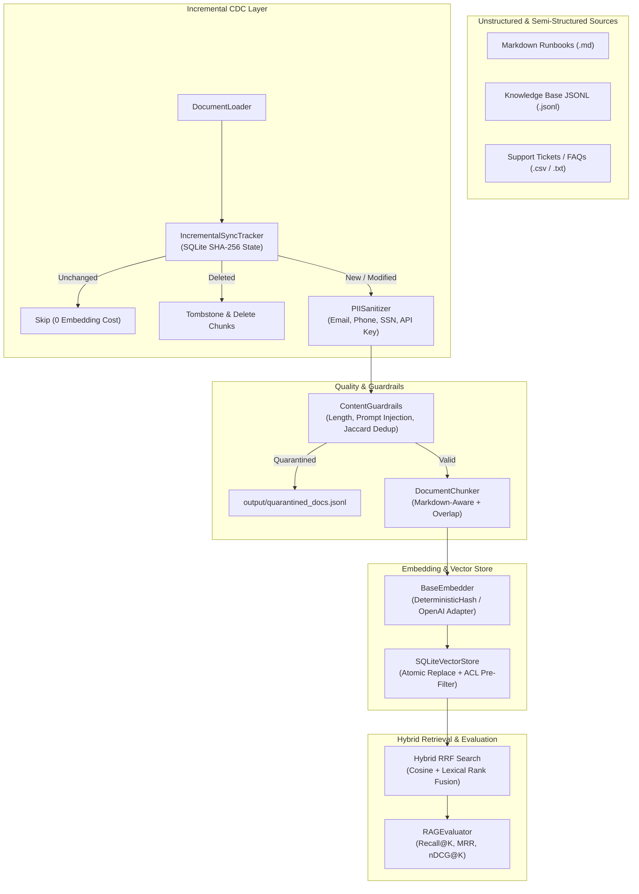

# Project 21: AI / LLM Data Engineering Pipelines

[](https://www.python.org/downloads/)
[](tests/)
[](architecture.md)

Enterprise-grade reference implementation for building **AI / LLM & RAG Data Engineering Pipelines** as part of **Data Engineering Diaries** by **Sathiya Murthy**.

This project treats LLM context preparation as a deterministic, idempotent **data engineering pipeline** — complete with SHA-256 incremental CDC sync, pre-embedding PII redaction, prompt-injection & near-duplicate guardrails, Markdown-aware chunking, batched embedding with exponential backoff, ACL-scoped hybrid (vector + lexical RRF) retrieval, and automated Recall@K / MRR evaluation.

---

## Architecture Diagram



---

## Directory Structure

```text
21_ai_llm_data_pipelines/
├── README.md                              # Project overview & quick start
├── architecture.md                        # System architecture & data contracts
├── design-decisions.md                    # Chunking, RRF, CDC & vector store tradeoffs
├── performance.md                         # Batch sizing, token cost & latency tuning
├── troubleshooting.md                     # Common RAG pipeline failure runbook
├── interview-questions.md                 # 15+ AI/LLM Data Engineering interview Q&As
├── requirements.txt                       # Dependencies (PyYAML, pytest)
├── configs/
│   └── pipeline_config.yaml               # Central pipeline, chunking, and retrieval config
├── sample-data/
│   ├── docs/                              # Sample runbooks & JSONL KB with PII & ACLs
│   └── eval_golden_set.json               # Golden benchmark queries for Recall@K & MRR
├── src/
│   ├── models.py                          # Immutable RawDocument, TextChunk, SearchResult
│   ├── ingestion/
│   │   ├── document_loader.py             # .md, .txt, .jsonl, .csv loaders
│   │   └── incremental_sync.py            # SQLite SHA-256 CDC sync tracker
│   ├── quality/
│   │   ├── pii_sanitizer.py               # Regex PII & credential redaction
│   │   └── content_guardrails.py          # Prompt-injection & Jaccard near-dedup
│   ├── chunking/
│   │   └── chunker.py                     # Markdown heading-aware & fixed token chunker
│   ├── embeddings/
│   │   └── embedder.py                    # DeterministicHash & OpenAI-compatible adapters
│   ├── vector_store/
│   │   └── sqlite_vector_store.py         # Atomic upsert, ACL filter, Hybrid RRF search
│   └── pipeline/
│       ├── rag_pipeline.py                # End-to-end orchestrator + cost/audit telemetry
│       └── evaluator.py                   # Recall@K, MRR, nDCG@K evaluator
├── tests/
│   ├── conftest.py
│   ├── test_chunking_and_sanitizer.py
│   ├── test_incremental_sync.py
│   ├── test_vector_store_and_retrieval.py
│   └── test_rag_pipeline_e2e.py
└── notebooks/
    └── 01_llm_data_pipeline.ipynb         # Interactive walkthrough notebook
```

---

## Quick Start

```bash
# Run all unit & end-to-end integration tests
python -m pytest projects/21_ai_llm_data_pipelines/tests -v
```
