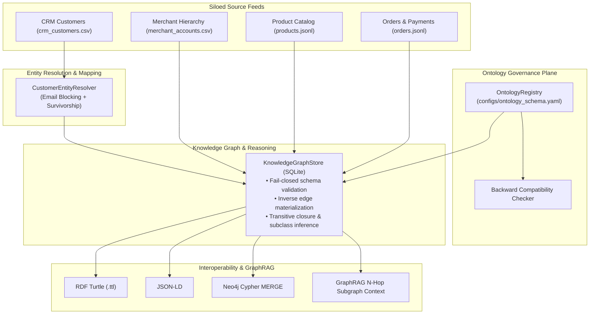

# Project 22: Enterprise Data Ontology & Knowledge Graphs

[](https://www.python.org/downloads/)
[](tests/)
[](architecture.md)

Enterprise-grade reference implementation for **Data Ontologies, Semantic Layers, Entity Resolution, and Knowledge Graphs** as part of **Data Engineering Diaries** by **Sathiya Murthy**.

This project demonstrates how modern data platforms (Palantir Foundry-style Object/Link ontologies, RDF/OWL semantic models, and GraphRAG) unify siloed relational tables and JSON streams into a **schema-governed, reasoner-backed Knowledge Graph**.

---

## Architecture Diagram



---

## Directory Structure

```text
22_data_ontology_knowledge_graphs/
├── README.md                              # Project overview & quick start
├── architecture.md                        # Ontology layers & GraphRAG integration
├── design-decisions.md                    # Property Graph vs RDF, fail-closed validation
├── performance.md                         # Indexing, transitive closure & traversal scaling
├── troubleshooting.md                     # Common schema, resolution & graph cycle issues
├── interview-questions.md                 # Ontology & Knowledge Graph DE interview Q&As
├── requirements.txt                       # Dependencies (PyYAML, pytest)
├── configs/
│   └── ontology_schema.yaml               # Enterprise E-Commerce & FinTech Ontology
├── sample-data/
│   ├── crm_customers.csv                  # Duplicate customer rows for entity resolution
│   ├── merchant_accounts.csv              # Multi-level merchant corporate hierarchy
│   ├── products.jsonl
│   └── orders.jsonl
├── src/
│   ├── models.py                          # ClassSpec, RelationshipSpec, GraphNode, GraphEdge
│   ├── schema/
│   │   └── ontology_registry.py           # Inheritance, validation, compatibility checks
│   ├── mapping/
│   │   └── entity_resolver.py             # Blocking-key resolution & survivorship
│   ├── graph/
│   │   └── knowledge_graph.py             # SQLite graph store, reasoning & BFS traversal
│   ├── exporters/
│   │   └── graph_exporter.py              # Turtle, JSON-LD, Cypher, GraphRAG context
│   └── pipeline/
│       └── ontology_pipeline.py           # End-to-end Knowledge Graph builder
├── tests/
│   ├── conftest.py
│   ├── test_ontology_registry.py
│   ├── test_entity_resolution.py
│   ├── test_knowledge_graph_reasoning.py
│   └── test_exporters_and_e2e.py
└── notebooks/
    └── 01_ontology_knowledge_graph.ipynb  # Interactive walkthrough
```

---

## Quick Start

```bash
python -m pytest projects/22_data_ontology_knowledge_graphs/tests -v
```
